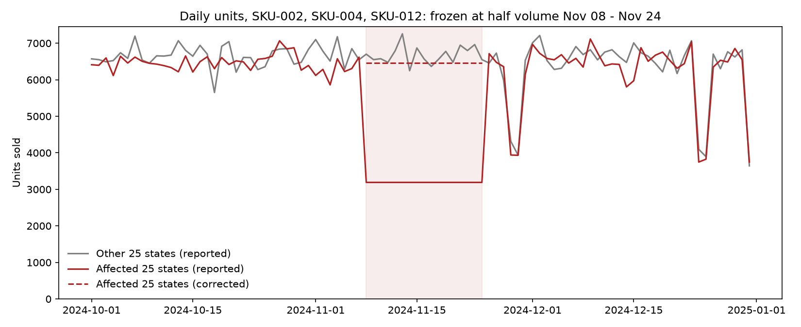
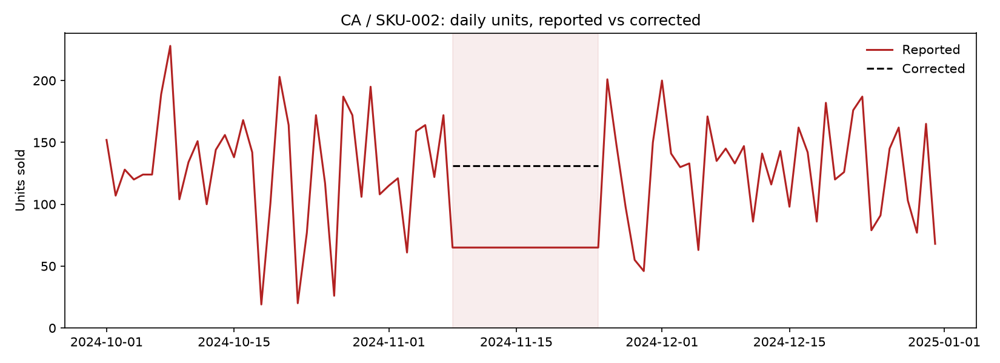

# Memo: Q4 2024 sales data issue

**To:** Customer Success | **From:** Data Operations | **Date:** November 5, 2026
**Re:** Client feedback that "something feels off" with their data

## Problem

Over 99% of the client's data is fine. We found one contained glitch (see chart in Appendix C):

- For 3 products (SKU-002, SKU-004, SKU-012) in 25 states, the numbers froze from **Nov 8 to Nov 24, 2024**.
- Each product/state reported the same number every day, at about **half** its normal level.
- That is 1,275 of 230,000 daily records (about 0.5%) and 55,488 units missing.
- The 25 states are exactly the first 25 alphabetically (AK through MS). Real buying doesn't follow the alphabet: this was a processing error on our side, not a change in customer behavior.

## Impact

The gap is small (under 1% of Q4 units) but concentrated, so it can steer decisions the wrong way:

- **A slowdown that didn't happen.** These products look like they fell 20% from October to November. The real drop was 6%, the same as every other product.
- **Wrong top sellers.** SKU-002 and SKU-004 are really the #2 and #3 sellers nationally. The data shows them as #4 and #5.
- **Bad planning inputs.** Reorders, forecasts or regional comparisons that use Nov 8–24 undercount these products by about half in those 25 states.

## Proposed Solution

- **Now:** A corrected file is ready to send. We replaced the frozen values with each product/state's own daily average from Oct 1 to Nov 7. Tested on the 25 states that weren't affected, it came within 0.4% of actual totals (about ±7% for a single product in a single state), so treat it as an interim estimate.
- **Final:** Re-run those records from the source and redeliver.

**What to tell the client:** "You were right. A processing error understated three products in 25 states for Nov 8–24. Everything else checks out. A corrected file is attached, and final numbers will follow."

## Go Forward Plan

- **Frozen-value check:** before every delivery, flag any product/state that repeats the exact same number for 7+ days (14+ for slow sellers, which can repeat by chance).
- **Peer check:** flag any product/state that drops or spikes for several days versus other states or its own recent average.
- **Compare to last delivery:** reconcile each file against the previous one.
- **Hold if a check fails:** the delivery waits for review, so the client never finds our errors first.
- **Fix the cause:** find and fix the step that wrote half-values for the AK–MS batch, and add a test for it.

<!-- pagebreak -->

## Appendix

### A. Method

1. Checked the full Q4 2024 file (Oct 1 to Dec 31; 230,000 daily product/state records) for missing days, duplicates, negatives and odd values. None found.
2. Looked for any product/state reporting the exact same number several days in a row. Only one pattern showed up: SKU-002, SKU-004 and SKU-012 in the first 25 states (AK through MS), Nov 8 to Nov 24.
3. Compared those series with the other 25 states and with their own Oct 1 to Nov 7 history. The stuck value equals half the Oct 1 to Nov 7 daily average for each product/state.
4. Replaced the 1,275 stuck values with each product/state's own Oct 1 to Nov 7 daily average. To check this, we applied the same method to the same window in the 25 unaffected states: totals came within 0.4% of actual, and about ±7% for a single product/state.
5. Holiday dips (Thanksgiving/Black Friday, Christmas Eve/Day, New Year's Eve) hit every state and product on the same days by a similar amount. They are normal seasonality, not errors.

### B. Impact by product

| | SKU-002 | SKU-004 | SKU-012 |
|---|---|---|---|
| National Q4 units understated | -4.6% | -4.7% | -4.8% |
| 25 affected states, Nov 8 to Nov 24 | about -50% | about -50% | about -50% |
| 25 affected states, full Q4 | about -9.5% | about -9.5% | about -9.5% |

- National rank: SKU-002 is really #2 (reported #4); SKU-004 is really #3 (reported #5).
- Affected products, October to November: -19.8% as reported, -6.2% actual. All other products: -6.0%.
- Total units missing: 55,488 (under 1% of all Q4 units).

### C. Charts



*The 3 products in the 25 affected states (red) track the other 25 states (grey) until Nov 8, then drop to a flat line at half volume until Nov 24. The dashed line is the correction.*



*One example series: California, SKU-002. Normal daily swings, then a flat line at half height, then back to normal.*

### D. How to reproduce

Requires Python 3.11+. From the repo root:

```
python -m venv .venv
source .venv/bin/activate      # Windows: .venv\Scripts\activate
pip install -r requirements.txt
python analysis.py
```

The corrected file is written to `output/sales_fixed.csv` and the charts to `charts/`.
